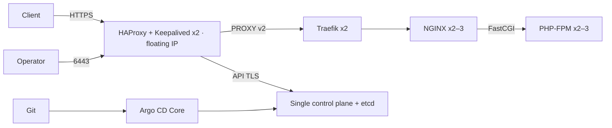

# Digipay SRE lab

Vagrant creates five local VMs. Kubespray installs Kubernetes and its prerequisites.

| VM | IP | RAM | vCPUs | Intended role |
| --- | --- | --- | --- | --- |
| lb | 192.168.56.13 | 512 MiB | 1 | Preferred HAProxy/Keepalived |
| lb2 | 192.168.56.14 | 512 MiB | 1 | Standby HAProxy/Keepalived |
| cp1 | 192.168.56.11 | 3 GiB | 2 | Control plane and etcd |
| worker1 | 192.168.56.21 | 3 GiB | 2 | Application and platform workloads |
| worker2 | 192.168.56.22 | 3 GiB | 2 | Application and platform workloads |

The lab uses libvirt/KVM, Ubuntu 24.04 guests, containerd, and Calico.
Kubespray uses kubeadm internally, so it fits the brief's kubeadm requirement.
See the [upstream explanation](https://github.com/kubernetes-sigs/kubespray/blob/master/docs/getting_started/comparisons.md#kubespray-vs-kubeadm).



[Full architecture and walkthrough](docs/architecture.md).

## Limits

Keepalived moves the floating address `192.168.56.10` between two dedicated
load-balancer VMs. This covers failure of one LB or its HAProxy process; it does
not make the single control plane, etcd member or physical host highly available.
Existing TCP connections can break during failover. See [load-balancer setup and
checks](docs/load-balancing.md).

## Automation

[Ansible project layout and verification](docs/automation.md). Activate the controller
environment with `source .venv/bin/activate`. After the cluster and images are
ready, the complete platform and check commands are:

```sh
ansible-playbook -i inventory/lab/hosts.yml ansible/main.yml -e lab_phase=platform
ansible-playbook -i inventory/lab/hosts.yml ansible/main.yml -e lab_phase=verify
```

Bring up the lab in this order: host prerequisites → VMs → cluster → images →
platform → verification. Before the first complete platform run, copy the built
image tags from `.state/app-images.json` into `gitops/application.yaml`, review,
commit and push them to the configured repository. Otherwise Argo may reconcile
image references that are unavailable on the workers. See [GitOps](docs/gitops.md)
for repository settings and image updates.

The component commands below follow the same order using tags. Argo CD owns
application deployment after bootstrap; rerunning Ansible does not upgrade its
Helm release.

## Host setup

Use Ubuntu 24.04 amd64 with Git, Python 3 and `python3-venv` available.
Image builds also require a running Docker daemon accessible to your user,
Docker Buildx, and Docker API 1.48 or newer (`docker image save --platform`).
Platform installation requires Helm 3.21.3 on `PATH`. The host setup role installs
virtualization dependencies; it does not replace an existing Docker installation.

Run as your normal user:

```sh
python3 -m venv .venv
source .venv/bin/activate
bash scripts/prepare-kubespray.sh
ansible-playbook ansible/main.yml -e lab_phase=host --ask-become-pass
```

This installs QEMU/libvirt and build dependencies from Ubuntu, Vagrant 2.4.9
from HashiCorp's package server with a pinned SHA-256 checksum, and the
vagrant-libvirt 0.12.2 plugin. It enables libvirtd and adds your user to the
libvirt and kvm groups. Sudo prompts for your password in the terminal.

Log out and back in, then check the host:

```sh
ansible-playbook -i inventory/lab/hosts.yml ansible/main.yml -e lab_phase=preflight
```

The preflight phase is read-only and exits with status 1 for missing
prerequisites. Setup follows the [Vagrant installation guidance](https://developer.hashicorp.com/vagrant/install)
and [libvirt plugin requirements](https://vagrant-libvirt.github.io/vagrant-libvirt/installation.html).

## Create the VMs

The five VMs reserve 10 GiB RAM in total. Free at least 11.5 GiB of available host
memory before starting all five, allowing some room for virtualization overhead.
The bounded 10 → 30 RPS comparison is recorded in [capacity](docs/capacity.md);
it is not a maximum-throughput claim.

```sh
vagrant validate
vagrant up --provider=libvirt --no-parallel
vagrant status
vagrant ssh cp1
```

The box is `bento/ubuntu-24.04`, pinned to `202508.03.0` for libvirt/amd64.
The lab network is isolated on `192.168.56.0/24`; the separate management network
uses NAT on `192.168.121.0/24` for SSH and outbound downloads. Neither overlaps
the host routes checked during setup. Check again if VPN routes change.

Use `vagrant halt` to stop the VMs and release their memory.

## Provision Kubernetes

Once all five VMs are running:

```sh
bash scripts/prepare-kubespray.sh
ansible-playbook -i inventory/lab/hosts.yml ansible/main.yml -e lab_phase=cluster
```

This checks SSH access, configures HAProxy, runs Kubespray, and applies host
hardening. Re-run the playbook after an interrupted provisioning attempt.
Use the verification playbook below to check the resulting cluster.

Kubespray is pinned to v2.32.0, commit
`9751ea6f63244e433a7a6263d9ecf381e57bb8e9`. The inventory pins Kubernetes 1.36.4,
containerd 2.3.5, etcd 3.6.14, and Calico 3.31.7 from that release's supported
versions. Kubespray handles swap, kernel/network prerequisites, and systemd
cgroup alignment. Calico uses VXLAN on the lab network.

HAProxy forwards API traffic at `192.168.56.10:6443` to `cp1`; TLS terminates at
the API server. It also forwards application HTTP/HTTPS to Traefik on the workers.

The generated admin kubeconfig and matching kubectl binary stay under the
Git-ignored `.state/artifacts/` directory:

```sh
export KUBECONFIG="$PWD/.state/artifacts/admin.conf"
.state/artifacts/kubectl get nodes -o wide
```

Check API readiness, Calico, CoreDNS, in-pod DNS, Service routing, and pod HTTP
traffic in both directions between the workers:

```sh
ansible-playbook -i inventory/lab/hosts.yml ansible/main.yml -e lab_phase=verify --tags cluster
```

The check creates two small BusyBox pods in a temporary namespace and removes
the namespace when it finishes. The image is pinned by digest.

SSH uses Vagrant's generated private keys and records first-seen host keys in
`.state/known_hosts`. After intentionally destroying and recreating a VM, remove
its old host key with `ssh-keygen -f .state/known_hosts -R <VM-IP>` before provisioning.

## Application

```sh
ansible-playbook -i inventory/lab/hosts.yml ansible/main.yml -e lab_phase=images
ansible-playbook -i inventory/lab/hosts.yml ansible/main.yml -e lab_phase=imagecheck
ansible-playbook -i inventory/lab/hosts.yml ansible/main.yml -e lab_phase=platform --tags metrics
ansible-playbook -i inventory/lab/hosts.yml ansible/main.yml -e lab_phase=platform --tags app
```

See [application settings and checks](docs/application.md) for the endpoints,
PHP-FPM pool budget, deployment, and test results. The Helm release runs in
`dpg-app`. Install and check ingress with:

```sh
ansible-playbook -i inventory/lab/hosts.yml ansible/main.yml -e lab_phase=platform --tags ingress
ansible-playbook -i inventory/lab/hosts.yml ansible/main.yml -e lab_phase=verify --tags ingress
```

See [ingress and TLS](docs/ingress.md) for the local HTTPS command and client-IP path.

## Monitoring

```sh
ansible-playbook -i inventory/lab/hosts.yml ansible/main.yml -e lab_phase=platform --tags monitoring
ansible-playbook -i inventory/lab/hosts.yml ansible/main.yml -e lab_phase=verify --tags monitoring
```

See [monitoring](docs/monitoring.md) for Grafana access, credentials, storage limits,
and scrape coverage. This phase uses ephemeral storage to fit the local lab.

## Application dashboard and SLOs

```sh
ansible-playbook -i inventory/lab/hosts.yml ansible/main.yml -e lab_phase=platform --tags observability
ansible-playbook -i inventory/lab/hosts.yml ansible/main.yml -e lab_phase=verify --tags observability
```

Open **Digipay application** in Grafana (`/d/dpg-application`).
See [SLO targets and alert delivery](docs/alerting.md).

## Failure exercises

See [the two bounded lab exercises](docs/failure-exercises.md) and their measured
postmortems. They deliberately disrupt this lab; do not run them concurrently
or during deployment.

## GitOps and CI

```sh
ansible-playbook -i inventory/lab/hosts.yml ansible/main.yml -e lab_phase=platform --tags gitops
ansible-playbook -i inventory/lab/hosts.yml ansible/main.yml -e lab_phase=verify --tags gitops
bash scripts/setup-validation.sh
source .state/validation-venv/bin/activate
ansible-playbook -i inventory/lab/hosts.yml ansible/main.yml -e lab_phase=validate
```

Argo CD Core manages the application from `main`; use Git for chart changes.
See [GitOps ownership, image updates, CI, and rollback](docs/gitops.md).

## Operational handover

- [Architecture and walkthrough](docs/architecture.md)
- [Incident runbook](docs/runbook.md)
- [On-call, escalation, handover, and change review](docs/operations.md)
- [Measured 3× comparison and scaling/cost trade-offs](docs/capacity.md)
- [Security, secrets, payments data, and backup/recovery plan](docs/security-and-recovery.md)

Application: `https://app.dpg.test`; Grafana: `https://grafana.dpg.test`.
Resolve both to `192.168.56.10` and use `.state/tls/ca.crt`. Grafana's user is
`admin`; retrieve its password from `.state/monitoring/admin-password`. Argo CD
Core has no public UI. See the access and diagnostic commands in the runbook.

Clean rebuild, full Kubespray repeat provisioning, reboot persistence and restore
drills are not verified. Backup/on-call targets are proposals.
