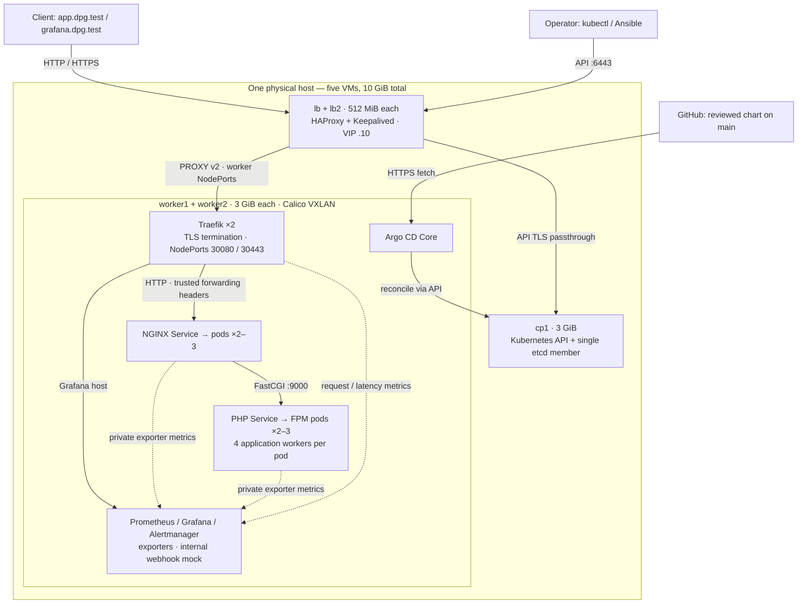

# Architecture

A request reaches the dedicated load balancer first. HAProxy keeps the original
source in PROXY v2, Traefik terminates TLS, and NGINX accepts forwarding headers
only from the trusted ingress network. PHP returns the resulting client IP.
NGINX and PHP are separate Deployments and Services; each normally has one pod
per worker. HPAs can raise each tier from two to three replicas. PDBs preserve
one healthy replica during permitted voluntary eviction, not arbitrary outages.

Monitoring observes ingress requests, connections, PHP workers, and Kubernetes
resources. Grafana has TLS and a generated admin login. Prometheus, Alertmanager,
and the notification mock have no public ingress. Their local data is ephemeral.
Argo CD reconciles the application chart from Git; infrastructure and platform
installation use Ansible roles. See [GitOps ownership](gitops.md).

Keepalived provides failover between two dedicated load-balancer VMs using one
floating address. Both HAProxy instances have the same backends and trust rules.
The control plane and etcd still each have one instance, and all five VMs share
one physical failure domain. A host or control-plane failure is not covered by
LB failover. Existing connections may need retry during VIP movement.
